# CodeCAD examples

Twelve drawings made with the CodeCAD JavaScript API, each saved as a DWG
and rendered from that DWG. They are meant to read like a draftsperson's
sheets: drafting conventions (centre lines, sections and hatching,
ISO-style dimensions), layers with ByLayer colours, linetypes and
lineweights, and a shared border and title block.

How they were made: each script was written by an AI agent and refined
over several passes. After every pass the agent rendered the saved DWG,
looked at the PNG, and fixed clipping, overlaps and drafting mistakes.
The scripts are not single-shot.

Shared code lives in [`lib/drafting.js`](lib/drafting.js). It covers what
the API doesn't do natively: paper-scaled layers and linetypes, the sheet
border and title block, leaders, centre marks and tables. Everything else
uses native `cad.*` calls. Colours are ACI palette indices, so DWG
save/reload is lossless.

## Reproducing

```bash
# server + a static server for the headless renderer (repo root)
RUST_LOG=info target/release/cadview-server ./examples/
python3 -m http.server 8790 -d .
# build the embeddable viewer once: cd web && pnpm exec vite build --config vite.embed.config.ts

# run script -> save DWG -> render PNG (960x640) from the saved DWG
bash examples/lib/export.sh 01-flange-plate 02-fibonacci-spiral ...
```

`export.sh` runs each script on a fresh server document through
`POST /api/run`, saves `examples/NN-name.dwg` with `cad.saveDwg`, then
`lib/render.mjs` loads that DWG in headless Chromium through
`<codecad-viewer>`. The PNG therefore also checks the DWG round trip.

## 01 - Flange Plate

**Prompt:** Plate flange DN80 PN16 (EN 1092-1 type 01) as a two-view
drawing: front view with the bolt pattern on its pitch circle, and full
section A-A with the holes revolved into the cutting plane. Scale 1:2.

**Exercises:** array (polar), regionClip (union/subtract) for the section
profile, addHatch, measure with `Ø<>` labels, addFill arrowheads, leaders,
cutting-plane line, title block

[JS source](01-flange-plate.js) | [DWG](01-flange-plate.dwg)

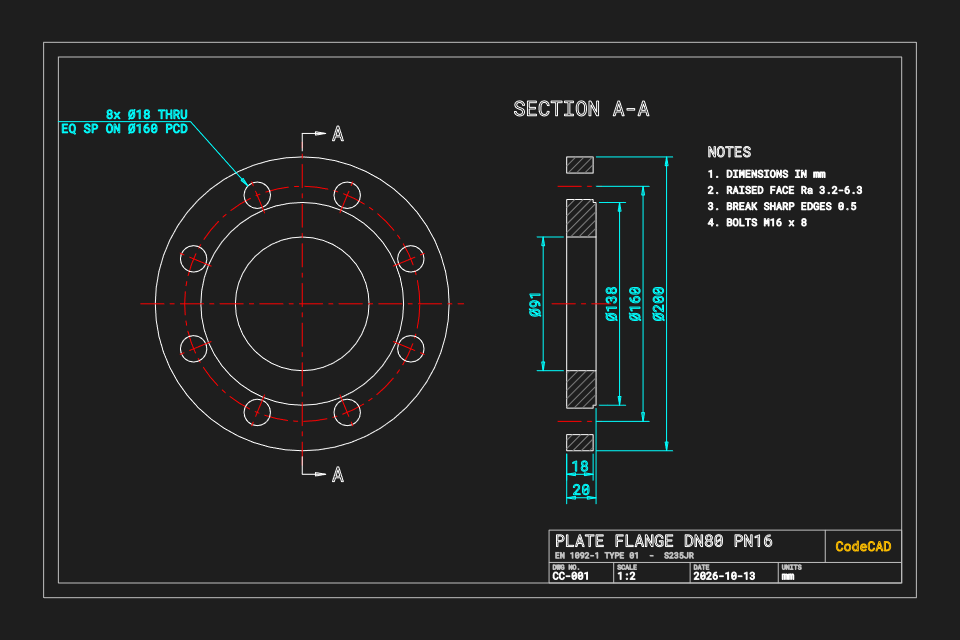

## 02 - Fibonacci Spiral

**Prompt:** A 144 x 89 rectangle tiled with Fibonacci squares. A quarter
arc in each square forms the spiral, and two construction diagonals meet
at its pole. Next to it, the compass construction of the golden rectangle
from a square (Euclid VI.30).

**Exercises:** addArc (p1/p2), lineCircleIntersection,
lineLineIntersection, procedural subdivision, measure, PHANTOM/THIN
layers

[JS source](02-fibonacci-spiral.js) | [DWG](02-fibonacci-spiral.dwg)

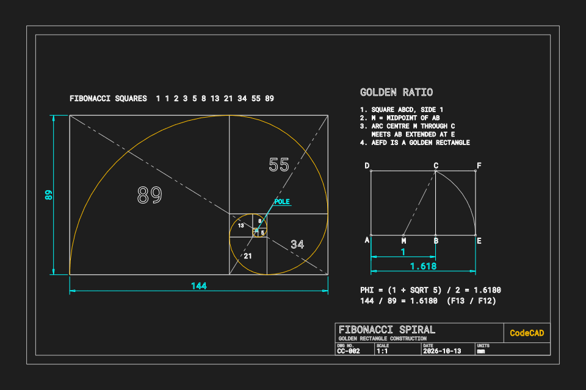

## 03 - Howe Roof Truss

**Prompt:** Howe timber truss with a 12 m span, 3 m rise and 6 panels.
Members are drawn at their real depth around the setting-out lines, with
nail plates, wall bearings, chained dimensions, the pitch angle and a
member schedule. Scale 1:50.

**Exercises:** lineLineIntersection (chord ends, apex), regionClip
(intersect/subtract) to cut every web to the chords and verticals, mirror,
addHatch, measure chains, dimAngle, scaled custom linetypes, table

[JS source](03-roof-truss.js) | [DWG](03-roof-truss.dwg)

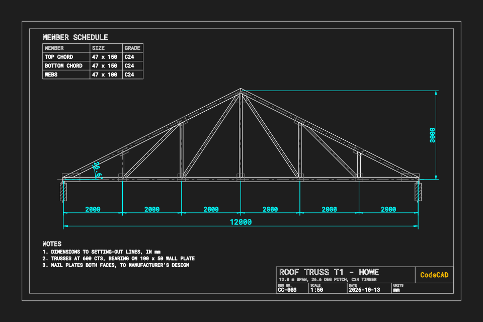

## 04 - DOL Motor Starter Schematic

**Prompt:** IEC 60617 schematic of a 3-phase direct-on-line starter. The
power circuit runs Q1 MPCB, KM1 contactor, F1 overload, M1 motor. The
control circuit runs F2, F1 95-96, S1 stop, S2 start with KM1 seal-in,
KM1 coil and H1 lamp. Includes terminal numbers, device tags, a parts list
and the sequence of operation.

**Exercises:** defineBlock symbol library, place, lineCircleIntersection
(motor entries), dashed mechanical linkage via ByLayer linetype, junction
dots, table

[JS source](04-motor-schematic.js) | [DWG](04-motor-schematic.dwg)

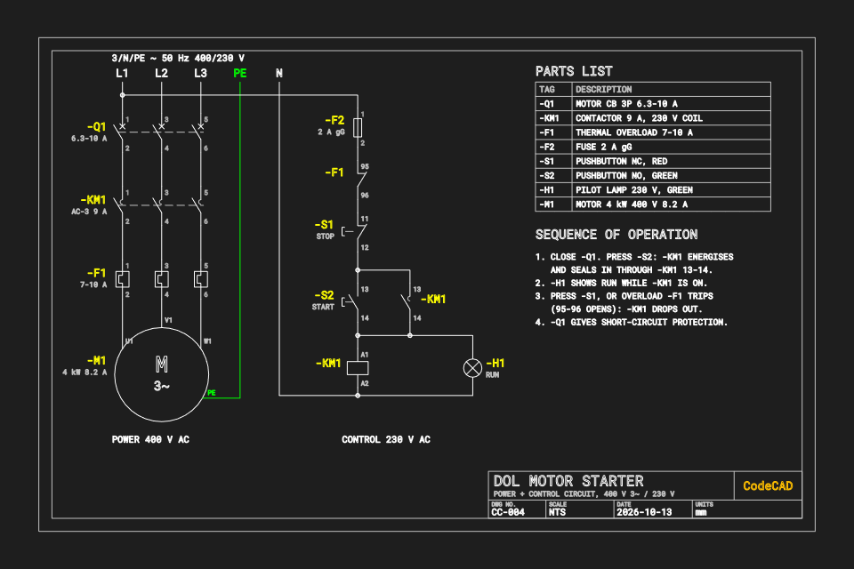

## 05 - Bicycle Frame Geometry

**Prompt:** Road frame (size 56) set out from the bottom bracket by stack
and reach, head and seat angles, BB drop, chainstay length and fork rake.
The tube silhouette is fused from the tube strips. Wheels, seat post,
saddle and bars are reference geometry, and a geometry chart lists the
numbers. Scale 1:8.

**Exercises:** lineCircleIntersection (rear axle), lineLineIntersection
(front axle, top tube), regionClip union, addSpline (saddle, bar), measure
h/v/aligned, dimAngle, table

[JS source](05-bicycle-frame.js) | [DWG](05-bicycle-frame.dwg)

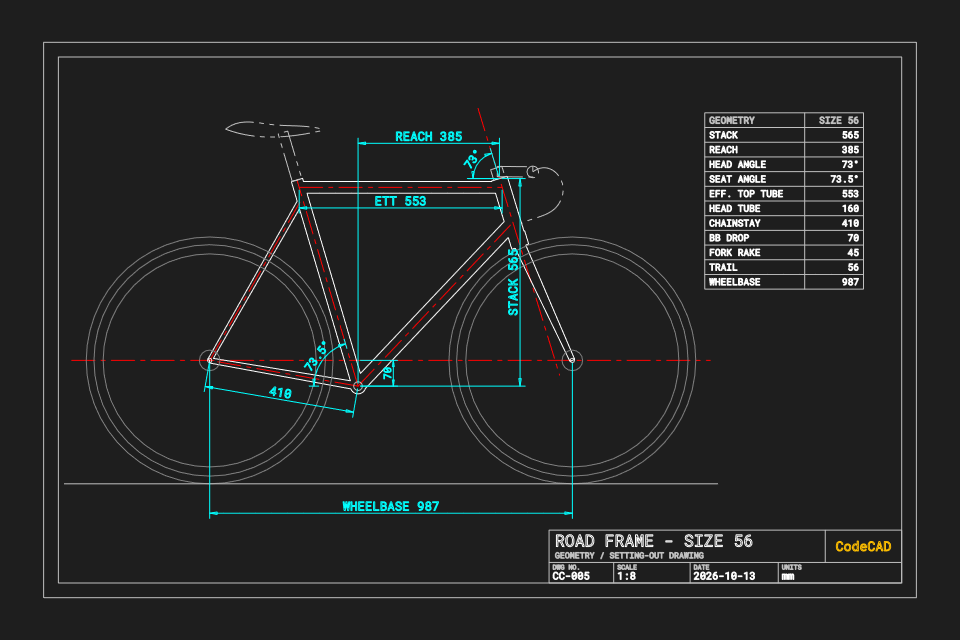

## 06 - Piston Section

**Prompt:** Piston and connecting rod as a half-section assembly at 1:1.
The rod shank is shown with a conventional break, and DETAIL A shows the
ring grooves at 3:1. The piston is cut, the gudgeon pin is cut across and
hatched the other way, and the rod is not sectioned.

**Exercises:** fillet (line-circle) for the rod eyes, trimTo against
circles/lines (hidden parts, break), addSpline break lines, regionClip
(pin cut, detail clip), addHatch, dimDiameter, measure with label
override, table

[JS source](06-piston-section.js) | [DWG](06-piston-section.dwg)

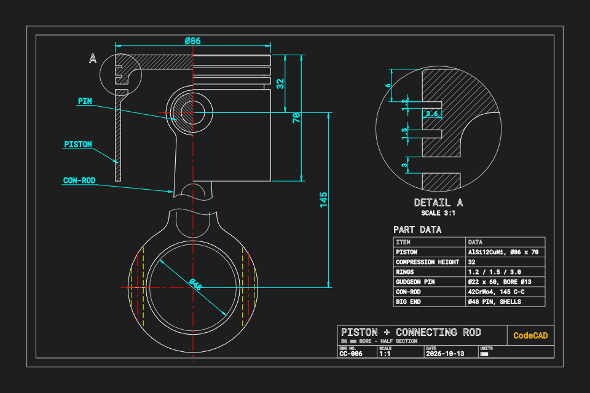

## 07 - Floor Plan

**Prompt:** One-bedroom apartment with a study at 1:50. Walls are solids
(300 mm external, 100 mm partitions) fused with a union, with door and
window openings cut out. Rooms and their areas come from interior minus
walls. Includes a door block with handing, furniture, chained dimensions,
a north arrow and a room schedule.

**Exercises:** regionClip (union, subtract, areas), addHatch with holes,
defineBlock + place with rotation and negative scale, measure chains,
addFill, table

[JS source](07-floor-plan.js) | [DWG](07-floor-plan.dwg)

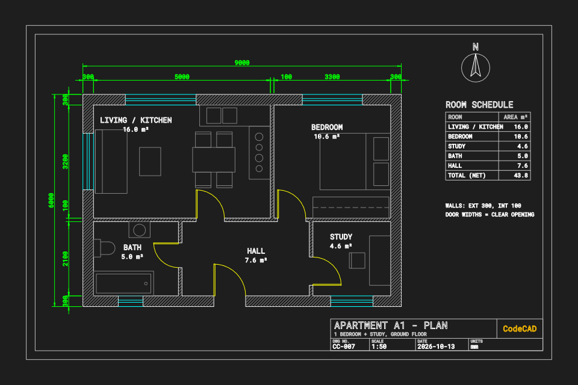

## 08 - Distribution Board

**Prompt:** Single-line diagram of a domestic distribution board. The
supply feeds the meter, a 63 A main switch and the busbar. A 300 mA RCD
group and a 30 mA RCD group feed MCB circuits C1-C10, plus a type 2 SPD.
Each circuit is labelled with number, rating, phase, cable and
description. The legend is drawn from the same block library.

**Exercises:** defineBlock (with text and per-shape layers), place (scale,
rotation), rotated text, PHANTOM enclosure

[JS source](08-distribution-board.js) | [DWG](08-distribution-board.dwg)

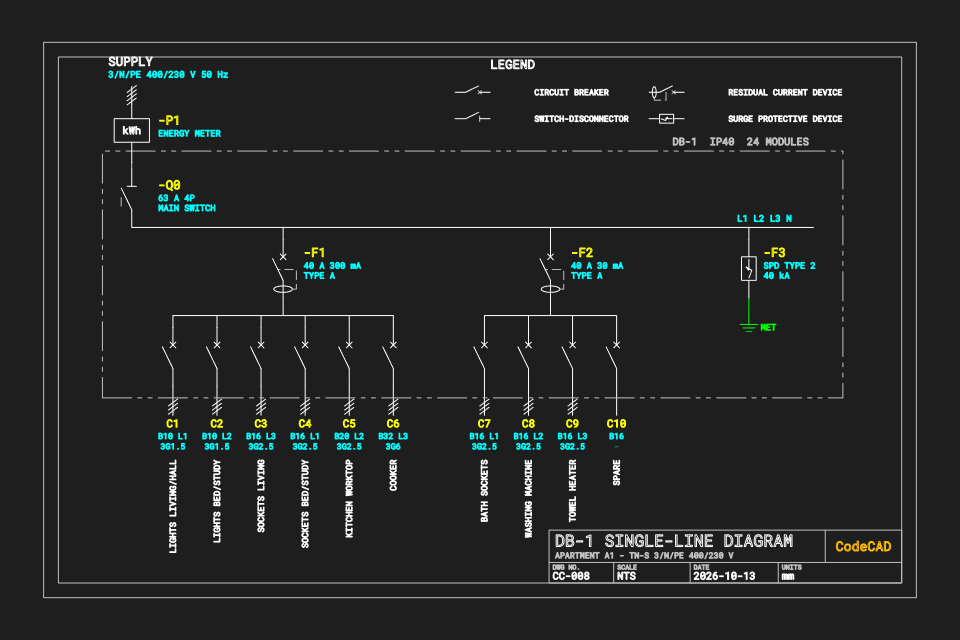

## 09 - Spur Gears

**Prompt:** A meshing pair of true involute spur gears (m3, 18/30 teeth,
20°) at the standard 72 mm centre distance. Shows pitch and base circles,
the line of action as the inner common tangent of the base circles, bores
with keyways, and a gear data table.

**Exercises:** addSpline (involute flanks), fillet (root fillets),
array (one tooth + gap repeated, lightening holes), tangentLines, trimTo
(keyways), dimDiameter, table

[JS source](09-spur-gears.js) | [DWG](09-spur-gears.dwg)

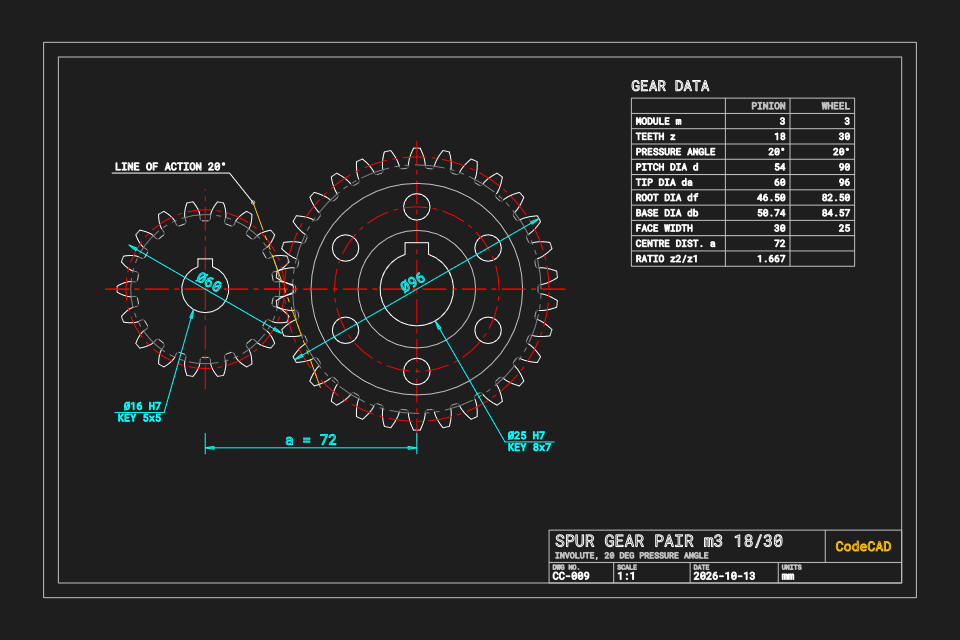

## 10 - Cam and Follower

**Prompt:** Disc cam with an in-line roller follower, generated from its
motion law: cycloidal 20 mm rise over 120°, 60° dwell, cycloidal return
over 120°, 60° dwell. The profile is the roller envelope of the pitch
curve. A displacement diagram, timing angles, the maximum pressure angle
and a motion table are included.

**Exercises:** addSpline (closed fit, pitch curve and profile), dimAngle,
trimTo (keyway), addHatch (follower guide), measure, table

[JS source](10-cam-follower.js) | [DWG](10-cam-follower.dwg)

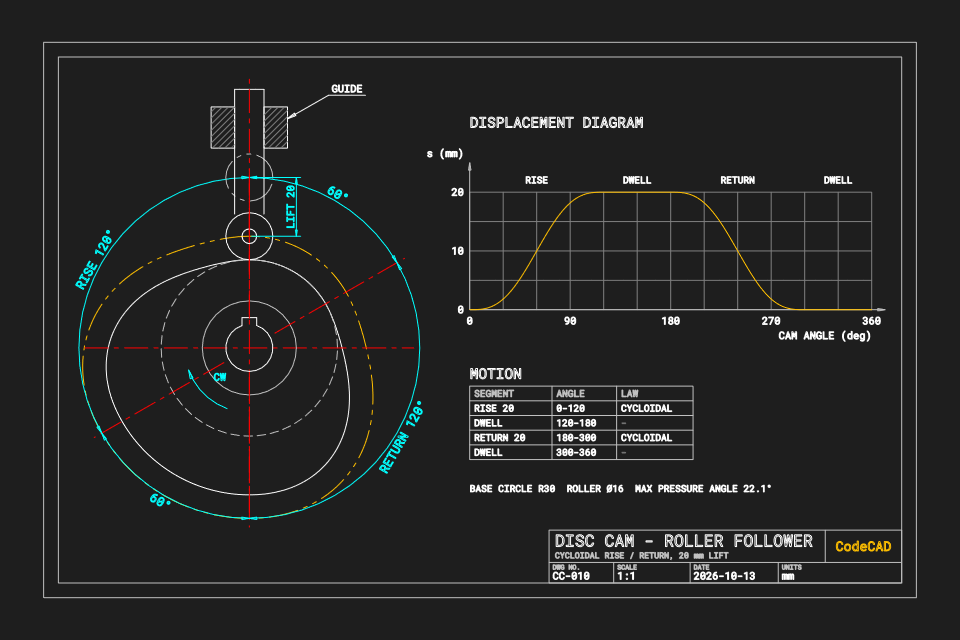

## 11 - P&ID

**Prompt:** A small P&ID. A feed tank has level control (LT, LIC, LCV),
and a pump P-101 delivers through a check valve and isolation valve, past
a PI, with a flow loop (FT, FIC, FCV) on to an exchanger. ISA 5.1 bubbles
come from one template block via clone + replaceText. Includes line
numbers, flow arrows, off-page connectors and a legend.

**Exercises:** defineBlock with text placeholders, clone + replaceText,
place, addFill flow arrows, dashed signal lines via ByLayer linetype

[JS source](11-pid.js) | [DWG](11-pid.dwg)

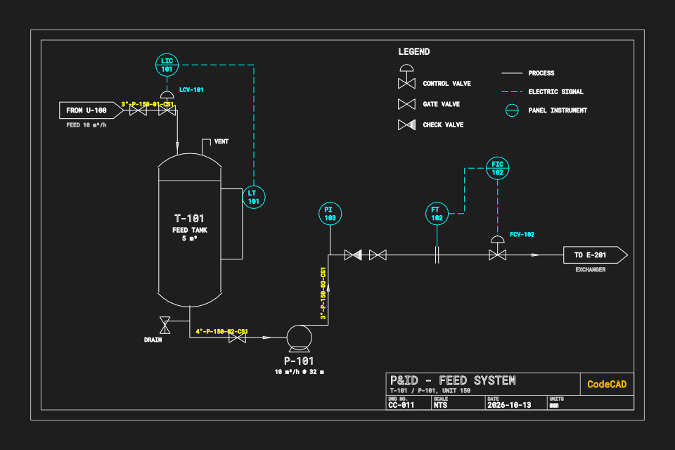

## 12 - Site Plan

**Prompt:** Site plan at 1:500. The boundary is plotted from a surveyor's
traverse (bearings and distances), and the closing leg is computed. The
building line is the boundary offset by the setbacks. Includes the
dwelling footprint, parking bays, spline contours, trees, street, north
arrow, scale bar and site data.

**Exercises:** offset + fillet (radius 0) to close the building line,
regionClip areas, addSpline contours, array (rect) + rotate, rotated
text, measure, table

[JS source](12-site-plan.js) | [DWG](12-site-plan.dwg)

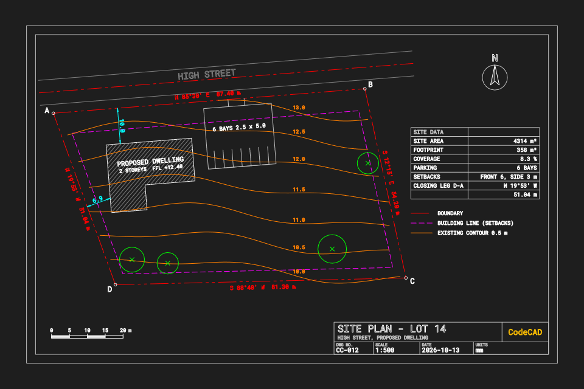
